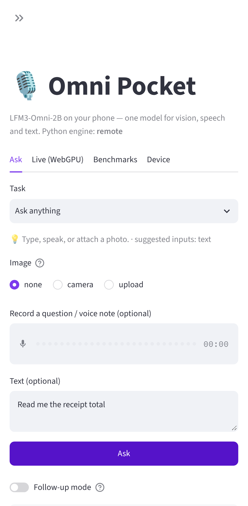
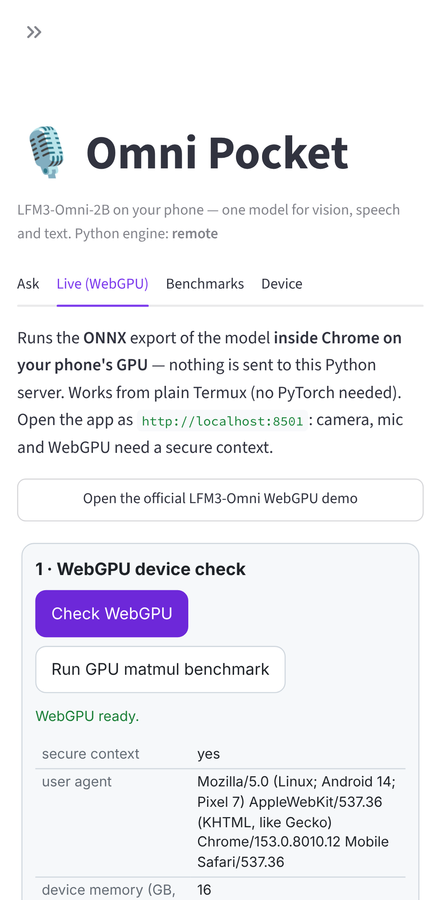

# 🎙️ Omni Pocket — LFM3-Omni-2B on your Android phone

A Streamlit workbench that runs on the phone itself (Termux or UserLAnd Arch) and
drives **LiquidAI LFM3-Omni-2B**. This is one ~2.17B end-to-end model that takes
**text + image + audio in** and gives **text (and speech) out**. It replaces the
usual ASR → VLM → LLM → TTS chain with a single model, fully local.

| Ask tab (phone) | Live WebGPU tab (phone) |
|---|---|
|  |  |

## What you can do with it

- **Spoken visual Q&A**: snap a photo, hold the mic, ask "is this ripe?", and hear the answer.
- **Read text, labels and receipts**: transcribe the text plus a one-line summary (total, expiry, dosage).
- **Translate a sign or menu** into any language.
- **Describe my surroundings**: short accessibility descriptions, read aloud.
- **Voice note → clean notes**: transcription rewritten as bullets with action items.
- **"What's wrong here?" / "What can I cook?"**: photo-based diagnosis and recipes.
- **Live camera + voice agent** running *inside Chrome on the phone GPU* (WebGPU).
- **Benchmarks**: every answer logs TTFT and tokens/s per engine and modality, with charts and JSONL export.
- **Device check**: RAM/disk/arch, WebGPU adapter, `shader-f16`, buffer limits, GPU matmul GFLOP/s.

Everything stays on your devices. Logs live in `omni_data/` and media is never stored.

## Pick an engine

| You have | Engine | Where the model runs |
|---|---|---|
| Plain **Termux** + Chrome 121+ | **Live (WebGPU)** tab | Phone GPU, in the browser (ONNX, q4f16) |
| Termux + a **PC with a GPU** | `remote` | PC, via `python -m omnipocket serve` (OpenAI-compatible) |
| **UserLAnd / proot Arch**, ≥ 8 GB RAM | `transformers` | Phone CPU, bfloat16 (slow but fully local Python) |
| Just exploring | `mock` | Nowhere (offline echo; exercises the whole UI) |

PyTorch has no wheels for Android/Bionic, which is why plain Termux uses
WebGPU or remote. A glibc proot such as UserLAnd installs PyTorch's aarch64
wheels from PyPI.

## Quick start

```bash
# Termux (F-Droid build)
pkg install -y git && git clone https://github.com/smkalle/vibe1 && cd vibe1/omni-pocket
./scripts/install_termux.sh          # 10-20 min the first time (compiles a few wheels)
./scripts/run.sh                     # opens http://localhost:8501 in Chrome

# UserLAnd / proot-distro Arch Linux ARM
sudo pacman -S --needed git && git clone https://github.com/smkalle/vibe1 && cd vibe1/omni-pocket
./scripts/install_userland_arch.sh --local   # adds torch + transformers
./scripts/run.sh

# GPU box serving the phone
./scripts/install_desktop.sh --server
OMNI_SERVER_API_KEY=$(openssl rand -hex 16) ./scripts/serve_gpu.sh
# phone: OMNI_ENGINE=remote OMNI_REMOTE_URL=http://<pc>:8088/v1 OMNI_REMOTE_API_KEY=<key> ./scripts/run.sh
```

Then check it all works offline: `./scripts/smoke_test.sh` (pytest, mock CLI, and a headless Streamlit boot).

## Guides

| Guide | Contents |
|---|---|
| [guides/TUTORIAL.md](guides/TUTORIAL.md) | The full tutorial: why, the Python baseline, the browser/WebGPU path, the native/mobile path, the real-time agent, optimisation |
| [guides/INSTALL_TERMUX.md](guides/INSTALL_TERMUX.md) | Termux step by step, Termux:API voice, Termux:Boot autostart |
| [guides/INSTALL_USERLAND_ARCH.md](guides/INSTALL_USERLAND_ARCH.md) | UserLAnd / proot-distro Arch, the local transformers engine, RAM budget |
| [guides/DEPLOY.md](guides/DEPLOY.md) | GPU server, Tailscale, systemd, API keys, LAN/HTTPS, updating |
| [guides/TROUBLESHOOTING.md](guides/TROUBLESHOOTING.md) | Known failure modes and fixes |

## CLI

```bash
python -m omnipocket doctor                                   # device report + engine recommendation
python -m omnipocket ask --engine remote --image photo.jpg --audio question.wav --stream
python -m omnipocket bench --engine transformers --text "Hello" --runs 5 --warmup 1
python -m omnipocket serve --engine transformers --host 0.0.0.0 --port 8088
```

## Configuration (env vars)

| Variable | Default | Meaning |
|---|---|---|
| `OMNI_ENGINE` | `auto` | `mock`, `remote` or `transformers`. `auto` picks transformers if torch is installed, else remote if `OMNI_REMOTE_URL` is set, else mock |
| `OMNI_MODEL_ID` | `LiquidAI/LFM3-Omni-2B` | HF repo for the transformers engine |
| `OMNI_ONNX_MODEL_ID` | `LiquidAI/LFM3-Omni-2B-ONNX` | ONNX repo for the WebGPU tab |
| `OMNI_TRANSFORMERS_JS` | `4.0.0` | transformers.js version loaded in the browser |
| `OMNI_REMOTE_URL` / `OMNI_REMOTE_MODEL` / `OMNI_REMOTE_API_KEY` | | Remote engine target (the key is never written to disk) |
| `OMNI_DEVICE` / `OMNI_DTYPE` | `auto` | transformers engine (`auto` dtype = bfloat16) |
| `OMNI_MAX_NEW_TOKENS` | `256` | Generation budget |
| `OMNI_DATA_DIR` | `omni_data` | History and benchmark JSONL |
| `OMNI_HOST` / `OMNI_PORT` | `127.0.0.1` / `8501` | UI bind address (`run.sh --lan` = `0.0.0.0`) |
| `OMNI_SERVER_API_KEY` | | Require `Bearer` auth on `serve` |

## Layout

```
app.py                       Streamlit UI (Ask · Live (WebGPU) · Benchmarks · Device)
omnipocket/
  engines/{mock,remote,transformers_engine}.py   one contract: generate() + stream()
  webgpu/index.html          bidirectional Streamlit component (no npm build): probe, matmul bench, live agent
  serve.py                   OpenAI-compatible FastAPI server around any engine
  media.py                   EXIF-aware image prep; WAV decode/resample to 16 kHz with numpy only
  presets.py · history.py · platform.py · cli.py · config.py
scripts/                     install_{termux,userland_arch,desktop}.sh, run.sh, serve_gpu.sh,
                             termux_boot.sh, smoke_test.sh, update.sh
tests/                       40 offline tests (engines, server round-trip, media, AppTest UI)
```

## Status and honesty notes

- **Verified here**: the full test suite. A real HTTP round trip from phone client → server → engine. The UI on a Pixel-7 viewport in headless Chromium. The WebGPU probe sending results back to Python. The WGSL matmul benchmark.
- **Not verified here**: running the real model weights. Hugging Face was unreachable from the build sandbox. The transformers engine follows the model card's Python interface as given. The in-browser loader depends on a transformers.js release that supports LFM3-Omni. Its version, model class and per-graph dtypes are all editable in the sidebar, so you can match the ONNX model card without code changes. If it doesn't load, the **official WebGPU demo** button is one tap away.
- **Model-native speech output** (`speech: model voice`) is experimental. When it isn't available, answers are spoken by the phone's TTS (browser `speechSynthesis` or `termux-tts-speak`).
