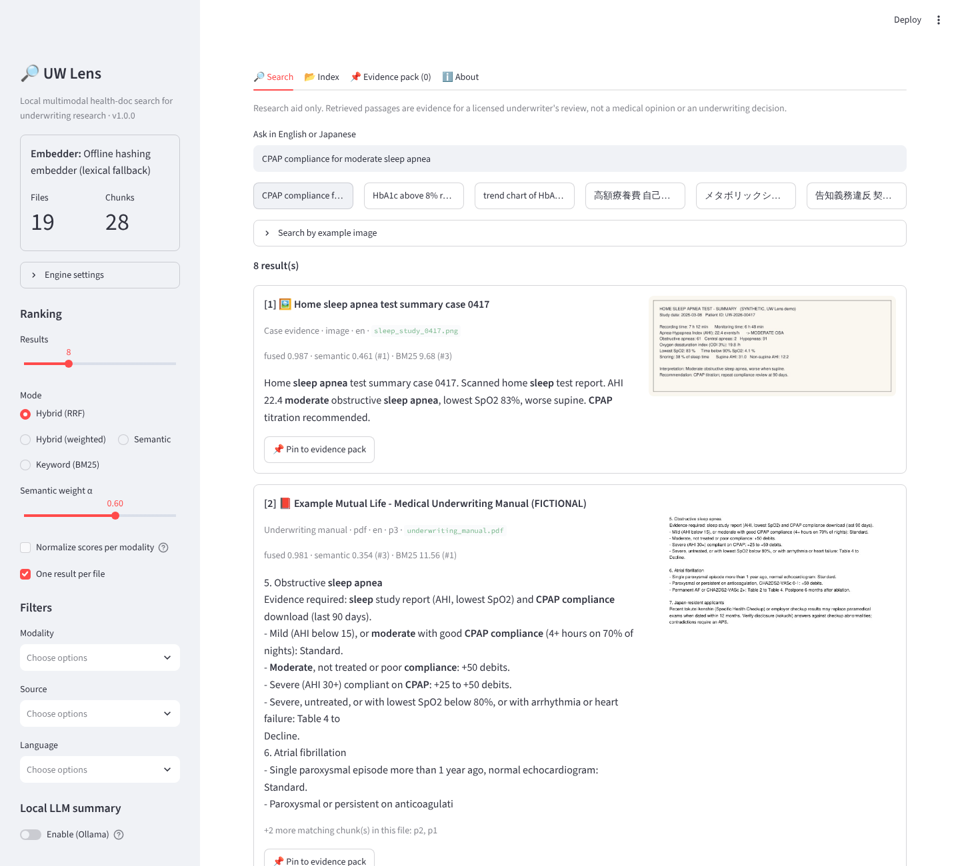
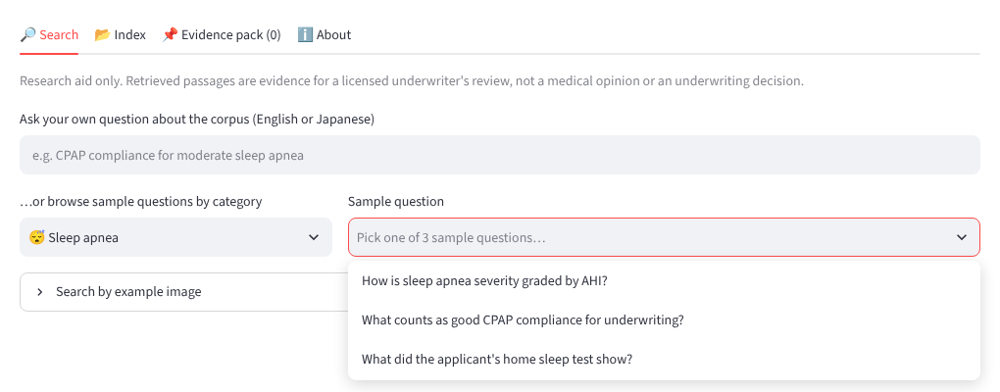
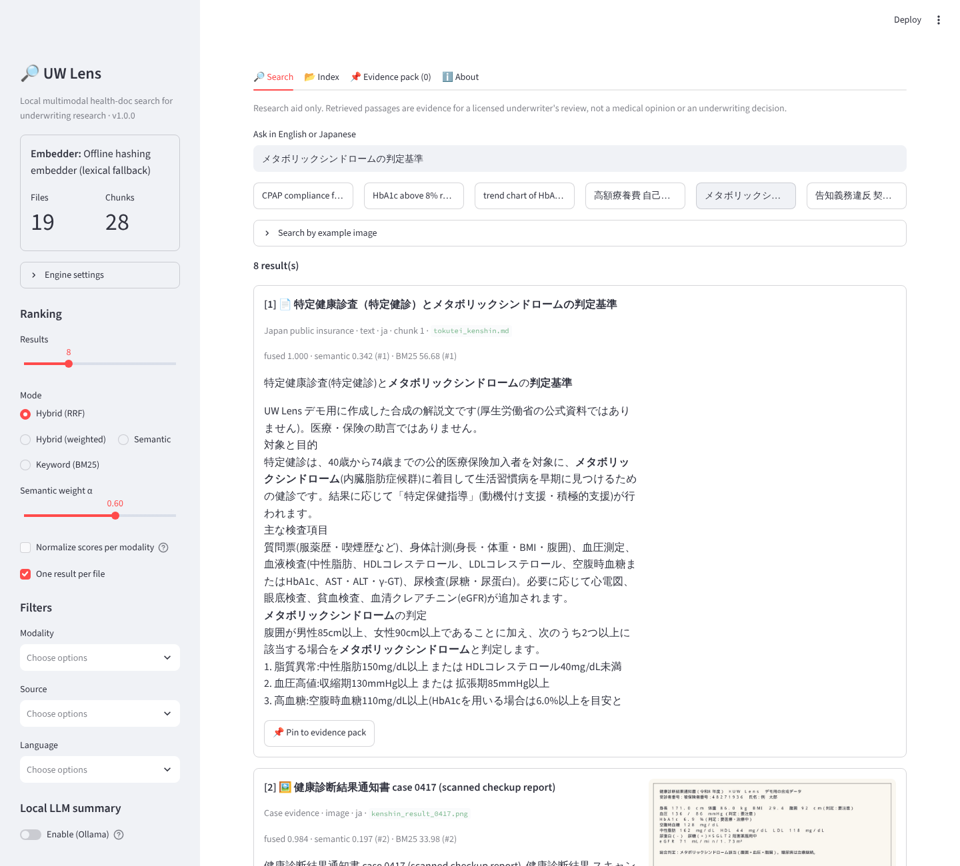
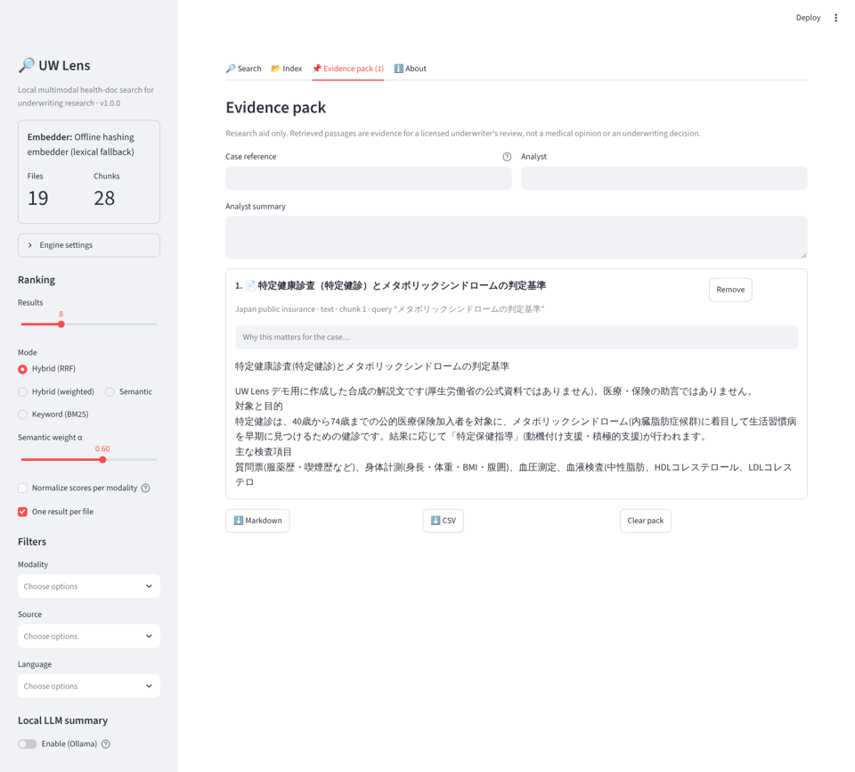

# UW Lens 🔎 — local multimodal health-document search for insurance underwriting

UW Lens is an open-source Streamlit app for **life and health underwriting research**. Point it at a folder
of mixed documents and search them in **English or Japanese**: clinical references (NIH/MedlinePlus style),
Japanese public-insurance documents (高額療養費, 特定健診, 介護保険, 告知義務), your underwriting manual
(PDF), and per-case evidence such as attending physician statements, scanned lab reports, sleep studies,
tele-interview audio and short videos.

It builds on the *EmbeddingGemma 2 local multimodal file searcher* tutorial (DigUp-style). EmbeddingGemma 2
maps text, code, images, audio and video into one 768-d space. UW Lens adds:
- hybrid BM25 ranking with Japanese bigrams
- PHI redaction
- an evidence-pack workflow
- an optional local-LLM research summary

Everything runs on your machine.

> **Research aid only.** Results are evidence for a licensed underwriter's review. They are not a medical
> opinion or an underwriting decision. The bundled corpus is **synthetic**. None of it is an official NIH or
> MHLW publication, and it contains no real patient data.





| Japanese query | Evidence pack |
|---|---|
|  |  |

## Quick start

```bash
cd uw-lens
./run.sh            # offline: hashing fallback embedder, sample corpus, opens the UI
./run.sh --gemma    # installs sentence-transformers + torch and uses EmbeddingGemma 2
```

To run each step by hand:

```bash
python -m venv .venv && source .venv/bin/activate
pip install -r requirements.txt          # add: -r requirements-gemma.txt for EmbeddingGemma 2
python -m uwlens sample                  # synthetic EN/JA corpus -> ./sample_corpus
python -m uwlens index                   # incremental; --rebuild to start over
python -m uwlens search "CPAP compliance for moderate sleep apnea"
python -m uwlens search "高額療養費 自己負担限度額" --source japan
streamlit run app.py
```

The first EmbeddingGemma 2 run downloads the model from Hugging Face. It's a gated model, so first accept
the Gemma license on the [model page](https://huggingface.co/google/embeddinggemma-2). Then either:
- paste a read token into the sidebar under **🤗 Hugging Face token**, or
- set `HF_TOKEN`, or run `huggingface-cli login`.

A token pasted in the sidebar lives only in that browser session's memory. UW Lens never writes it to disk,
logs, the index or a cache key, and only a masked form (`hf_…1234`) is ever shown. **Forget token** clears it.
After the download, nothing leaves the machine.

## About EmbeddingGemma 2

UW Lens's semantic search is built on **EmbeddingGemma 2**, an open embedding model from Google DeepMind,
released on 6 October 2026. An *embedding model* turns an input into a list of numbers (a vector) so that
inputs with similar meaning end up close together. EmbeddingGemma 2 does this for **text, code, images,
audio and video in one shared space**. That shared space is what lets a typed question find a scanned lab
report, an interview recording or a short video.

### Key facts

| | |
|---|---|
| **Publisher / license** | Google DeepMind · Apache 2.0 (open weights on Hugging Face as `google/embeddinggemma-2`, and on Kaggle) |
| **Size** | 740M parameters in total: a 270M text/code core, plus an optional 170M vision encoder and an optional 300M audio encoder |
| **Output** | 768-dimensional vectors. Matryoshka training means you can keep just the first 512, 256 or 128 numbers and still get usable vectors |
| **Context** | 8,192 tokens, shared by all modalities in one input |
| **Inputs** | Text, code, images, audio and video, alone or interleaved in one input (placeholders such as `<\|image\|>` mark where media go) |
| **Prompts** | Text uses task prompts. Queries use `SearchQuery` and indexed content uses `Document`. Media are encoded without a prompt |
| **Footprint** | Google reports about 191 MB of active RAM for text-only and about 567 MB for the full multimodal model, quantized on a phone (Pixel 11 Pro) |
| **Runtimes** | sentence-transformers / Transformers. Ollama, vLLM and MLX support has also been reported |

### Modular loading

The encoders load only when needed, and every configuration writes into the **same** vector space. A
text-only query therefore matches an image that was indexed with the full model.

| Configuration | Parameters | UW Lens setting (`UWLENS_MODALITIES`) | Good for |
|---|---|---|---|
| Text only | ≈270M | `text` | PDFs, notes, manuals, code; lowest memory |
| Text + vision | ≈440M | `vision` | Adds scanned reports, charts, screenshots and video frames |
| Text + audio | ≈570M | *(not exposed yet)* | Audio without images |
| Full | ≈740M | `full` (default) | All modalities |

With the `text` setting, UW Lens embeds each image's or recording's sidecar caption or transcript instead
of its pixels or sound. Those files stay searchable, just not by what they look or sound like.

### How UW Lens uses it

- **Asymmetric prompts.** Your question is encoded with `SearchQuery`. Indexed text and PDF pages use
  `Document`, and code uses `CodeRetrieval` when the model defines that prompt.
- **Media as dictionaries.** Media are passed as `{"image": path}`, `{"video": path}` or `{"audio": array}`.
  Audio is cut into 30-second windows of 16 kHz mono so long recordings stay inside the 8K-token context.
- **Normalized vectors.** Every vector is normalized to unit length, so cosine similarity is a dot product.
  When you pick a smaller Matryoshka size (`UWLENS_DIM`), vectors are truncated and then normalized again.
- **Precision.** UW Lens uses bfloat16 on GPUs that support it, otherwise float32, and never float16, which
  can produce NaNs. A NaN guard rejects bad vectors.
- **Index pinning.** The index records the model and dimension it was built with. Switching either one asks
  for a rebuild instead of silently mixing incomparable vectors.
- **Hybrid ranking.** The semantic score is fused with BM25 keyword matching, because embeddings can miss
  exact identifiers such as drug names, ICD-style codes or table names.

### Getting access

The model is **gated**: accept the Gemma license on its
[Hugging Face page](https://huggingface.co/google/embeddinggemma-2) first, then authenticate in any one of
these ways:
- paste a read token into the sidebar (**🤗 Hugging Face token**)
- set `HF_TOKEN`
- run `huggingface-cli login`

Install the extra dependencies with `pip install -r requirements-gemma.txt` (sentence-transformers ≥ 6.1,
transformers, torch, torchcodec). Video and audio decoding also needs `ffmpeg` on your PATH. The first run
downloads the weights; after that, everything runs offline.

### Things to know

- **Benchmarks.** Google reports a large gain in code retrieval (MTEB Code 68.76 → 78.68) and multilingual
  text results roughly level with the previous EmbeddingGemma. These are Google's own numbers. UW Lens has
  not reproduced them, and nobody has measured EmbeddingGemma 2 on UW Lens's own corpus yet. Run
  `UWLENS_EMBEDDER=gemma python run_evals.py` to measure it on your data.
- **Media budgets.** The tutorial this project follows gives these defaults: about 280 tokens per image,
  video sampled at about 1 frame per second at about 140 tokens per frame, and audio at about 25 tokens per
  second. Long video has to be split into clips before indexing.
- **Precision.** Avoid float16: the model card warns it can produce NaNs.
- **Not a clinical model.** EmbeddingGemma 2 is a general-purpose retriever. It finds related evidence; it
  doesn't interpret it. Every result still needs an underwriter's review.

Primary references:
- [Hugging Face model page](https://huggingface.co/google/embeddinggemma-2)
- [EmbeddingGemma 2 model card](https://ai.google.dev/gemma/docs/embeddinggemma/model_card_2)
- [Google launch post](https://blog.google/innovation-and-ai/technology/developers-tools/embeddinggemma-2/)
- [Developer guide](https://developers.googleblog.com/embeddinggemma-2-the-developer-guide/)

## What it does

| Area | Details |
|---|---|
| **Modalities** | `.txt .md` · code `.py .js .ts .sql .json .yaml` · `.pdf` (per page) · images · audio (30 s windows, 16 kHz mono) · video |
| **Sidecars** | Optional `<file>.meta.json` with `title`, `source`, `language`, `caption`, `transcript`, `segments`, `tags`. These stand in for OCR/ASR, feed BM25, and let the offline fallback find media |
| **Hybrid ranking** | Semantic cosine + BM25. Fusion modes: RRF (default), weighted, semantic-only, keyword-only. Optional per-modality z-normalization, because image/audio cosines run lower than text. One result per file |
| **Asking questions** | Type your own question about the corpus, or pick a **category** (Diabetes & metabolic · Sleep apnea · Cardiovascular & kidney · Japan public insurance · Disclosure & underwriting rules · Case 0417 evidence) and then one of its **3 sample questions** (EN and JA). Samples live in `uwlens/questions.py`; a test checks that each one finds its source document in the top 5 |
| **Bilingual** | NFKC normalization (ＨｂＡ１ｃ → HbA1c), CJK bigram tokens, language detection (en/ja/mixed), Japanese highlighting |
| **Filters** | Modality, source (`nih` / `japan` / `policy` / `case`, from the folder name or sidecar), language |
| **PHI redaction** | On by default and applied *before embedding*. Masks emails, phones (US/JP), SSN, My Number, member/policy/被保険者番号 IDs, labelled names (`Patient name:` / `氏名：`) and dates of birth. Clinical values (HbA1c, BP, dates of tests) are kept. The indexer re-scans stored text and warns about anything left over |
| **Evidence pack** | Pin results, add per-item notes, a case reference and an analyst summary, then export Markdown or CSV |
| **Local LLM summary** | Optional and off by default. Ollama `/api/chat` on **localhost only** (remote URLs are refused). The model must answer only from the numbered evidence, cite `[n]`, and never make a rating/decision |
| **Index** | NumPy store (exact cosine, default) or Chroma (`UWLENS_STORE=chroma`). Incremental by content hash, including sidecar edits; deleted files are purged. The manifest pins embedder and dimension, so vectors from different models never mix |
| **Embedders** | EmbeddingGemma 2 with modular loading: `text` ≈270M, `vision` ≈440M, `full` ≈740M parameters. Matryoshka 128/256/512/768. bf16 only when supported, never fp16. An offline **hashing fallback** keeps everything working without the model |

## Configuration (environment)

| Variable | Default | Meaning |
|---|---|---|
| `UWLENS_EMBEDDER` | `auto` | `auto` (Gemma, else fallback) · `gemma` (fail if unavailable) · `hashing` |
| `UWLENS_MODEL_ID` | `google/embeddinggemma-2` | any sentence-transformers model with the same prompt names |
| `UWLENS_MODALITIES` | `full` | `text` · `vision` · `full` |
| `UWLENS_DIM` | `768` | Matryoshka truncation: 128 / 256 / 512 / 768 |
| `UWLENS_STORE` | `numpy` | `numpy` · `chroma` |
| `UWLENS_INDEX_DIR` | `./uwlens_index` | index location |
| `UWLENS_CORPUS_DIR` | `./sample_corpus` | default folder to index |
| `UWLENS_REDACT_PHI` | `1` | `0` disables redaction (not recommended) |
| `UWLENS_CHUNK_CHARS` / `UWLENS_AUDIO_WINDOW_S` | `1200` / `30` | chunking |
| `OLLAMA_URL` / `OLLAMA_MODEL` | `http://localhost:11434` / `gemma3:4b` | local summary |

## The offline fallback: what it can and can't do

When EmbeddingGemma 2 can't load (no torch, no network, CI), UW Lens switches to a deterministic
character-n-gram **hashing embedder** and shows a warning in the sidebar. The fallback is **lexical**:
- It can't see pixels or hear audio. Media are found through their sidecar captions/transcripts.
- It can't match across languages. For example, "long-term care insurance" won't find 介護保険.
- Image-to-document search is disabled.

Use EmbeddingGemma 2 for real semantic, cross-modal and cross-lingual retrieval.

## Tests and evals

```bash
python -m pytest -q tests     # 57 tests, fully offline (unit + Streamlit AppTest UI flows)
python run_evals.py           # retrieval eval -> evals/REPORT.md
UWLENS_EMBEDDER=gemma python run_evals.py   # same eval with EmbeddingGemma 2
```

The tests cover:
- PHI redaction for English and Japanese
- chunking invariants
- store round-trips and embedder-mismatch protection
- incremental re-index (edit / delete / corrupt file / sidecar change)
- every fusion mode and filter
- the EmbeddingGemma 2 **call contract** (prompts, prompt-free media dicts, normalization, truncation, NaN guard, audio windowing), checked against a recording fake model
- RAG grounding and the localhost-only guard
- evidence export
- the full UI workflow, including a summary served by a fake local Ollama server

Current eval with the offline fallback, over 25 hand-labelled queries:

| Fusion | Same-language Recall@5 (n=21) | MRR | Cross-lingual Recall@5 (n=4) |
|---|---|---|---|
| Hybrid RRF | 1.000 | 0.952 | 0.500 |
| BM25 only | 1.000 | 0.905 | 0.250 |

The eval set is small and was written alongside the corpus, so treat it as a regression gate rather than
a benchmark. Run it with `UWLENS_EMBEDDER=gemma` to measure real semantic quality on your hardware.

## Known limitations

- Pattern redaction is a safety net, not certified de-identification (HIPAA Safe Harbor / APPI need a
  reviewed process). Text inside image or video *pixels* is not redacted.
- Videos are embedded whole. For long recordings, split them into clips or keyframes first. Audio is
  windowed at 30 s.
- No built-in OCR/ASR: provide sidecar text, or add Tesseract/Whisper output as sidecars.
- RRF always fills the result list. Low-ranked items may be weak matches, so check the score breakdown on
  each card.

## Layout

```
app.py              Streamlit UI (Search · Index · Evidence pack · About)
uwlens/             config, textproc, extractors, embedders, store, bm25, indexer, search, rag, evidence, cli
uwlens/sample_corpus.py + corpus_src/   synthetic EN/JA corpus generator (md, pdf, png, wav, mp4)
evals/              labelled queries + REPORT.md
tests/              pytest suite
```

Spec and verification plan: [`../specs/uw-lens.md`](../specs/uw-lens.md). License: the repository's
license (see `../LICENSE`). The sample corpus text is dedicated to the public domain (CC0).
